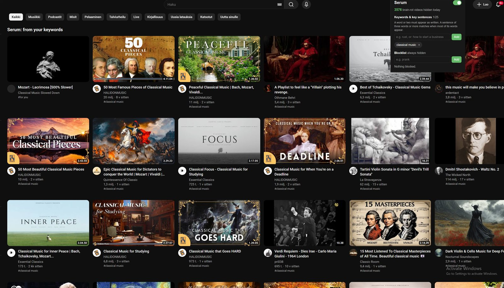
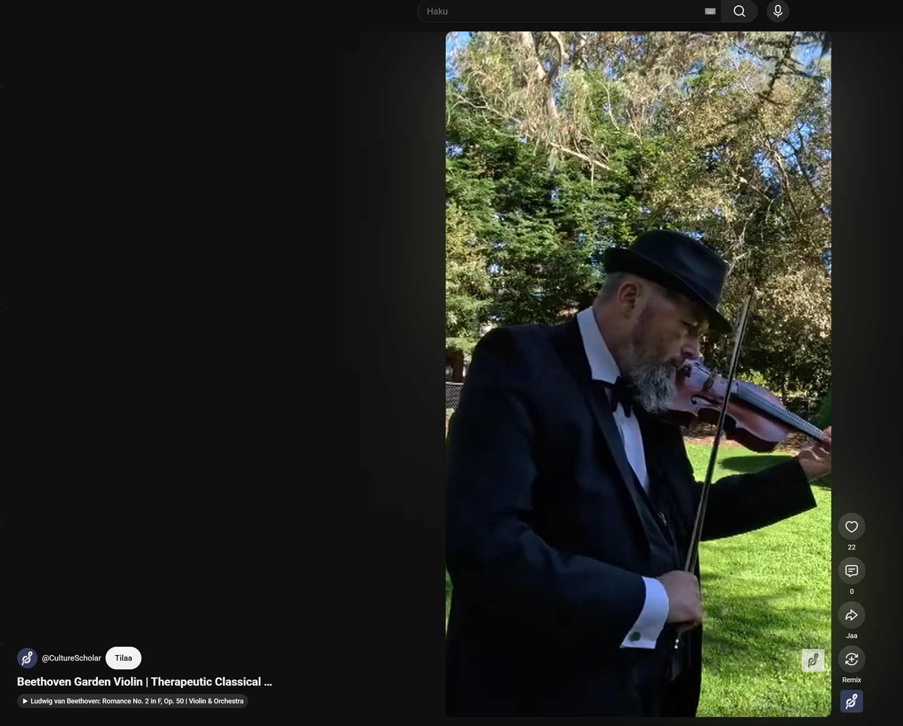

# Serum

A Chrome extension (Manifest V3) for personal use: YouTube shows only what
you actually want, on the homepage, the sidebar, search and Shorts.

There is no AI and no outside server. Everything runs in your browser. The
only requests Serum makes are to youtube.com itself, for the refill searches,
and to YouTube's own image hosts, i.ytimg.com (thumbnails) and
yt3.ggpht.com (channel pictures).

## What it looks like

With one keyword, `classical music`, the homepage is Serum's own feed, and
the popup is open on the right:

In Shorts, only Shorts that match are shown:

## What it does

- **Keywords.** Each video card is scored by matching your keywords against
  its title and channel name. Matching ignores case, and a keyword must stand
  as a whole word, so `rust` matches "Rust 1.80" but not "trust". A card that
  matches no keyword is hidden. You can have at most 25 keywords and key
  sentences together.
- **Key sentences.** A keyword of three words or more is a key sentence, such
  as `how to start a business online`. It matches when at least two thirds of
  its meaningful words appear, in any order. Little words like "how", "to"
  and "a" don't count, and a word may also end in s, es or 's. So the example
  matches "Start Your Online Business in 2026". In the feed, the sentence is
  searched as it is.
- **Two words** must both appear, in any order. A word may also end in s, es
  or 's. `classical music` matches "Music: classical favourites", and the
  hashtag `#classicalmusic` too. One word must appear as written.
- **Blocklist.** A card that matches a blocklist word is always hidden, even
  if it also matches a keyword.
- **No flashing.** Every video card is hidden until Serum has judged it, so a
  card that doesn't match never shows for a moment. Serum starts with the page
  (`document_start`). It judges each batch of new cards in its
  MutationObserver, before the browser paints them. Cards are judged again
  when YouTube reuses them for other videos.
- **An endless feed, in two places.** Serum draws its own feed, "Serum: from
  your keywords", in place of YouTube's list:
  - **on the homepage,** instead of the grid of cards (the chips bar stays);
  - **beside a video,** instead of the suggestions, as one column like
    YouTube's.
  - **What's in it.** The videos YouTube put there that match a keyword
    (tagged `#for you` on the homepage and `#related` beside a video), mixed
    with keyword search results, three keywords per round in turn. Beside a
    video, the matching suggestions come first.
  - **Where results come from.** The first page of a keyword is
    `https://www.youtube.com/results?search_query=<keyword>`, read from its
    `ytInitialData`. Later pages are fetched the way YouTube's own page does
    it: a continuation token sent to `youtube.com/youtubei/v1/search`.
  - **Scrolling.** When you scroll within about two screens of the end, the
    next 18 cards load, so you can scroll on until the right video shows up.
  - **What's skipped.** A video is never added twice, and blocklisted videos
    are skipped.
  - **Opening a video.** A click on a card opens the video the way YouTube's
    own links do (`main.js`): only the player changes, the site isn't loaded
    again. Ctrl-click and middle-click still open a new tab.
  - **The end.** The feed ends only when every keyword's results run out, and
    then it says so.
  - **Logging.** Each round is logged in the page's console as
    `[Serum] feed: ...`.
  - **Still YouTube's algorithm.** Serum recommends nothing itself; it only
    decides which of YouTube's videos you see.
    - The `#for you` and `#related` videos are the ones YouTube's
      recommendation algorithm picked for you.
    - The keyword results come from YouTube's search, in YouTube's order.
      When you're signed in, that search is personalised to your account too.
    - In Shorts, the ones that follow a Short come from YouTube's own
      sequence.
- **Shorts: only yours.**
  - **Judging.** Each Short is judged by its title and channel, read from
    YouTube's own oEmbed address. Until it is judged, the player is hidden and
    paused, so a Short that isn't yours is never seen or heard.
  - **Replacing.** Serum keeps a queue of matching Shorts, found by searching
    `<keyword> #shorts` and keeping those whose text matches. A Short that
    doesn't match is replaced at once by the next one from that queue. It
    opens the way YouTube's own links do (`main.js`), or by loading its
    address.
  - **Swiping.** After a match, YouTube's next Shorts tend to be of the same
    kind, and each one is judged again.
  - **Where the queue lives.** It is kept in the tab's `sessionStorage`, so it
    survives a reload. It starts again when you change your words.
  - **When it runs out.** Serum skips as YouTube would. After 30 skips in a
    row it stops and tells you.
- **Popup.** It has an on/off switch, the number of brain-rot videos hidden
  today (Shorts skipped count too), and the keyword and blocklist lists. The
  lists are saved in `chrome.storage.sync`, so they follow your Chrome
  profile.

- **Ads are left alone.** Serum never hides YouTube's ads. YouTube takes
  hidden ads for an ad blocker and then holds videos back for seconds before
  they start.

With no keywords at all, nothing is hidden for lack of a match; only the
blocklist applies.

## Install (Load unpacked)

1. Open `chrome://extensions` in Chrome.
2. Turn on **Developer mode** (top right).
3. Click **Load unpacked** and choose this folder (the one with
   `manifest.json`).
4. Pin Serum: click the puzzle-piece icon in the toolbar, then the pin next
   to Serum.
5. Open youtube.com, or reload it if it was already open.

After changing the code, click the reload arrow on Serum's card in
`chrome://extensions`, then reload YouTube.

## Use

- Click the Serum icon to open the popup.
- Add keywords. You can add several at once, separated by commas:
  `business, tech, computers, rust programming`.
- Remove a word with ×.
- Changes apply at once on open YouTube tabs.

The defaults are `business`, `tech`, `computers` and `rust`. Tip: `rust` on
its own also brings in videos of the game Rust; `rust programming` or
`rustlang` is narrower. With three words or more a keyword is a key sentence (see above). Commas separate entries, so a sentence can't
contain one.

## Files

| file | what it is |
|---|---|
| `manifest.json` | the extension's description, permissions (`storage` only) and content script |
| `lib.js` | matching and reading `ytInitialData`; no DOM, so Node can test it |
| `content.js` | runs on youtube.com: judging cards, Serum's feed, Shorts, the counter |
| `main.js` | runs in YouTube's own page world; opens a video or a Short the way YouTube's links do |
| `content.css` | hides cards until judged, and styles Serum's feed |
| `popup.html`, `popup.js`, `popup.css` | the popup |
| `test.js` | `node test.js` checks the matching and the parser; `node test.js --live` also reads a real search page |

## Limits

- YouTube changes its page structure now and then. The card and Shorts
  selectors are at the top of `content.js` (`CARD_SELECTOR`, `checkShorts`).
  When something stops being hidden, those are the places to look.
- Refill cards are Serum's own cards, laid out like YouTube's (thumbnail,
  channel picture, title, channel, views, age). They have no hover preview
  and no YouTube menu.
- The counter counts each hidden video once per page load, so a video hidden
  again after a reload counts again.
